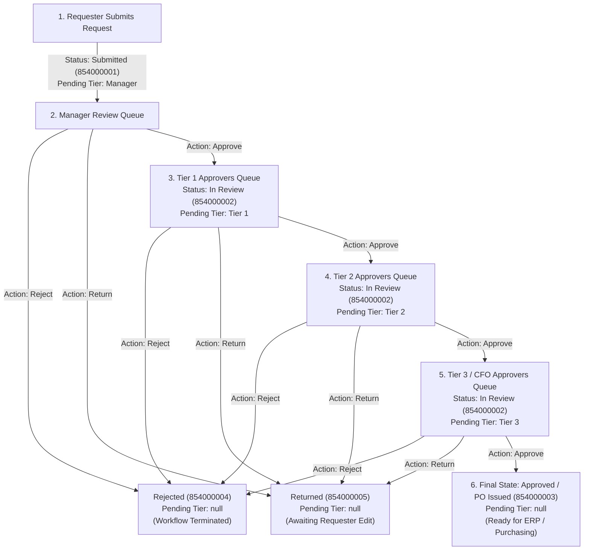

# Fortrex Spend Control (SCT) — End-to-End Workflow & Architecture Documentation

## 1. Executive Summary

The **Fortrex Spend Control Tracker (SCT)** is a SharePoint Framework (SPFx v1.20) enterprise application built with React and Fluent UI. It integrates with **Microsoft Dataverse** and **Microsoft Entra ID (Azure AD)** via Microsoft Graph API and SharePoint `AadHttpClient`.

This document details the end-to-end architecture, approval routing state machine, role-based access control (RBAC), Dataverse schema bindings, troubleshooting history, and solution packaging.

---

## 2. Solution Architecture & Component Hierarchy

```
AppShell (Header, Role Switcher, Tab Navigation)
 ├── Dashboard (KPI Cards, Role Filtered Views, Pending/Completed Queues)
 ├── NewRequestForm (Multi-tier Form, Cost Center, Graph /me/manager Resolution)
 ├── MyRequests (Author-centric View & Manager Audit View)
 ├── ReviewQueue (Approver Triage, Action Popups, Audit Log Inspection)
 └── RequestHistoryPanel (Slide-out Audit Logs & Approval Logs Drawer)
```

### Core Services
* **`DataverseService.ts`**: Low-level OData client wrapping `AadHttpClient`. Handles CRUD, multi-source master data merging, retry loops for undeclared attributes, and badge counts.
* **`approvalHandler.ts`**: Centralized approval state machine engine. Generates split payloads for parent request updates and audit approval logs.
* **`GraphMailService.ts`**: Resolves manager hierarchy (`/me/manager`) and dispatches notification emails via Microsoft Graph API.
* **`auditLogger.ts`**: Captures granular field change diffs into `sct_auditlogs`.

---

## 3. End-to-End Approval Lifecycle & State Machine

The SCT workflow implements a strict 4-stage sequential approval chain:



### Stage Transitions & Dataverse Value Mapping

| Stage | Acting Approver | Log Stamped (`sct_tiername`) | Destination Status (`sct_request_status`) | Destination Pending Tier (`cr2a4_pendingtier` / `sct_pendingtier`) |
|---|---|---|---|---|
| **Submission** | Requester | *None (Audit: Submitted)* | `Submitted` (`854000001`) | `'Manager'` |
| **Stage 1** | Manager | `4` (`Manager`) | `In Review` (`854000002`) | `'Tier 1'` |
| **Stage 2** | Tier 1 Approver | `1` (`Tier 1`) | `In Review` (`854000002`) | `'Tier 2'` |
| **Stage 3** | Tier 2 Approver | `2` (`Tier 2`) | `In Review` (`854000002`) | `'Tier 3'` |
| **Stage 4** | Tier 3 Approver | `3` (`Tier 3`) | `Approved` (`854000003`) | `null` |
| **Rejection** | Any Approver | Current Role Int | `Rejected` (`854000004`) | `null` |
| **Return** | Any Approver | Current Role Int | `Returned` (`854000005`) | `null` |

---

## 4. Key Engineering Scenarios & Bug Fixes

### Scenario 1: Separating Audit History from Routing Destination (`handleApprovalAction`)
* **Problem**: When a user approved a request, the audit approval log erroneously stamped the *next destination* tier (e.g. Manager approving stamped "Tier 1") instead of recording the current user's role.
* **Root Cause**: A single payload object was shared between parent request patching and child log creation.
* **Solution**: Separated into two distinct payloads:
  1. `logPayload`: Captures current acting role (`sct_tiername = tierInt`, `sct_approvalstatus`, `sct_comments`, `sct_decisionon`).
  2. `requestUpdatePayload`: Advances parent table destination (`sct_pendingtier = nextTier`, `sct_requeststatus`).

### Scenario 2: Dataverse Undeclared Navigation Properties (HTTP 400 Auto-Recovery)
* **Problem**: Submitting requests or approval logs failed with `Microsoft.OData.ODataException: An undeclared property 'sct_Manager' / 'sct_tier' / 'sct_status' was found in the payload`.
* **Root Cause**:
  * Manager lookup on `sct_requests` used publisher prefix `cr2a4_Manager`, not `sct_Manager`.
  * `sct_approvallogs` only declared option-set integers (`sct_tiername`, `sct_approvalstatus`), not text fields `sct_tier` or `sct_status`.
* **Solution**:
  * Corrected default lookup bindings to `cr2a4_Manager@odata.bind`.
  * In `DataverseService.ts`, implemented automatic retry loops on `createRequest` and `createApprovalLog`:
    ```typescript
    const match = msg.match(/undeclared property '([^']+)'/i);
    if (match && match[1]) {
      delete currentPayload[`${match[1]}@odata.bind`];
      delete currentPayload[match[1]];
      // retry POST seamlessly
    }
    ```

### Scenario 3: Manager Queue Visibility for Newly Submitted Requests (`SCT-2026-1036`)
* **Problem**: Request `SCT-2026-1036` (created by Bhakti Gandhi with manager Aniket Desai) did not appear in Aniket's Pending queue.
* **Root Cause**:
  1. `Dashboard.applyFilters()` required `isInReview` (`854000002`). Newly submitted records had status `Submitted` (`854000001`), causing them to be dropped.
  2. The manager check only inspected `_sct_manager_value` by exact GUID, ignoring `_cr2a4_manager_value` and OData formatted display name strings (`"Aniket Desai"`).
  3. `getManagerMasterRequests()` OData filter failed if direct reports were not synced to Dataverse's internal `systemusers` table.
* **Solution**:
  1. Updated `applyFilters()` to recognize `isPendingManagerStatus = isInReview || isSubmitted || rawStatus === 854000001`.
  2. Multi-prefix resolution: Checks `_cr2a4_manager_value`, `_sct_manager_value`, `_manager_value`, and formatted name matches.
  3. In `DataverseService.ts`, merged `getRawRequests()` into `getManagerMasterRequests()` with in-memory deduplication, guaranteeing newly created requests are always present.

### Scenario 4: Tier 1 Visibility & Missing Approval Logs
* **Problem**: After manager approved `SCT-2026-1036`, status became `In Review (Tier 1)`, but the request did not show in Tier 1 Pending queue, and `Request History` showed `Approval Logs (0)`.
* **Root Cause**:
  1. `reqId === safeUserId` in `applyFilters()` and `ReviewQueue.tsx` hid requests created by the active user, blocking test approvals.
  2. `createApprovalLog` failed silently due to undeclared string fields, preventing audit log creation.
  3. Tier matching only checked exact string `Tier 1` against `cr2a4_pendingtier`, missing compound status `In Review (Tier 1)`.
* **Solution**:
  1. Permitted tier approvers in `ReviewQueue` and `Dashboard` to review requests pending at their tier.
  2. Sanitized `logPayload` to send declared columns only (`sct_name`, `sct_tiername`, `sct_approvalstatus`, `sct_comments`, `sct_decisionon`).
  3. Updated `getApprovalLogs()` to order by `createdon desc`.
  4. Expanded tier matching to check both pending tier fields and status strings containing `tier 1`, `tier 2`, and `tier 3`.

### Scenario 5: Dynamic Authorized Role Dropdown
* **Problem**: Role dropdown displayed all 5 roles regardless of the logged-in user's authorized privileges.
* **Solution**: Updated `AppShell.tsx` to dynamically map `this.state.userRoles` directly to Fluent UI `Dropdown` options:
  ```tsx
  const dynamicRoleOptions = (this.state.userRoles || ['requester']).map((roleKey: string) => {
      let displayName = 'Requester';
      if (roleKey === 'manager') displayName = 'Manager';
      else if (roleKey === 'approver_tier1') displayName = 'Approver — Tier 1';
      else if (roleKey === 'approver_tier2') displayName = 'Approver — Tier 2';
      else if (roleKey === 'approver_tier3') displayName = 'Approver — Tier 3';

      return { key: roleKey, text: displayName };
  });

  <Dropdown
      options={dynamicRoleOptions}
      selectedKey={this.state.activeRole}
      // ...
  />
  ```

---

## 5. Security & Role Matrix (POC Environment)

| User | Primary Email | Authorized Roles |
|---|---|---|
| **Aniket Desai** | `Aniket.Desai@devrishabhsoft.onmicrosoft.com` | Requester, Manager, Approver — Tier 2, Approver — Tier 3 |
| **Bhakti Gandhi** | `Bhakti.Gandhi@devrishabhsoft.onmicrosoft.com` | Requester, Approver — Tier 1, Approver — Tier 3 |
| **Manav Barad** | `Manav.Barad@devrishabhsoft.onmicrosoft.com` | Requester, Manager, Approver — Tier 1, Approver — Tier 2 |

---

## 6. Build and Deployment Instructions

### Build Command
The solution is built and packaged using Microsoft Rush Stack Heft:
```powershell
npm run build
# Executes: heft test --clean --production && heft package-solution --production
```

### Generated Artifacts
* **SharePoint App Package**: `sharepoint/solution/ad-dataverse-fortrex.sppkg`
* **Bundle JavaScript**: `sharepoint/solution/debug/ClientSideAssets/ad-fortrex-webpart-web-part_*.js`

### Deployment Steps
1. Navigate to your SharePoint App Catalog:
   `https://dcvrishabhsoft.sharepoint.com/sites/FortrexSCT/AppCatalog`
2. Upload the updated `ad-dataverse-fortrex.sppkg`.
3. Select **"Enable this app and add it to all sites"** (or deploy to the Fortrex SCT site).
4. Refresh the SharePoint page (`Ctrl + F5`) to clear browser cache.
