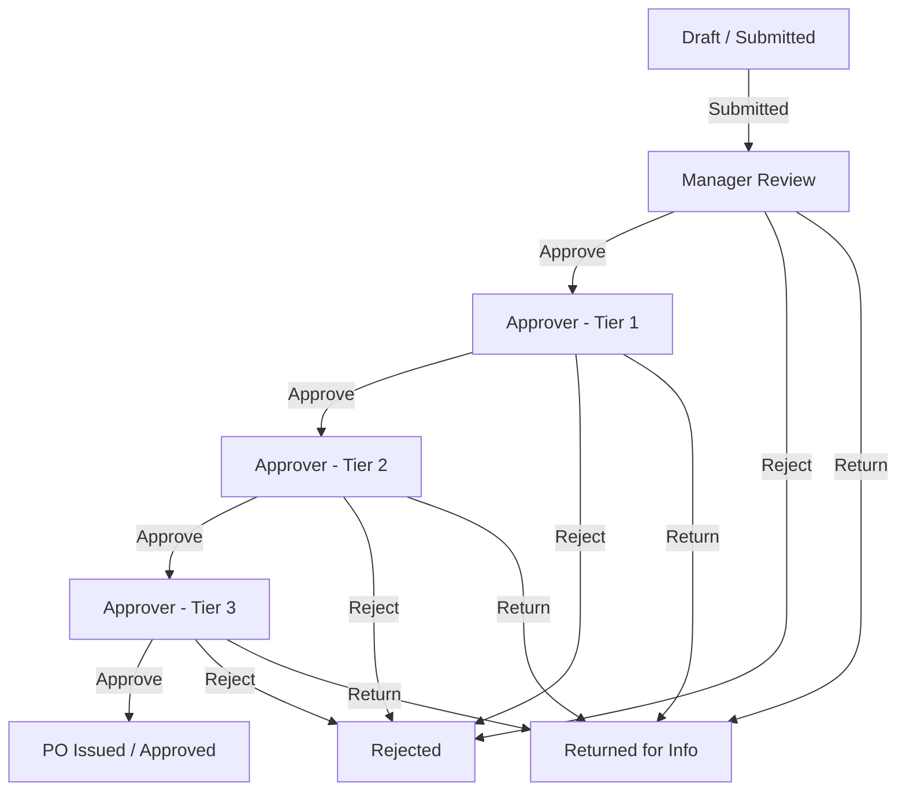

# Fortrex Spend Control — Multi-Tier Approval Workflow & Fix Report

## 1. Overview of Workflow Architecture

The Fortrex Spend Control approval process follows a strict sequential state machine across all tiers and user groups:



---

## 2. Root Cause Analysis: Why Requests Did Not Move to Tier 2 & Tier 3

We conducted an exhaustive audit of the routing and filtering pipeline and identified **5 critical loopholes**:

### Loophole 1: JavaScript Nullish Coalescing (`??`) Blocking Empty Strings
- **Problem**: When reading pending tier (`rawPt`), the code used:
  ```typescript
  const rawPt = req['cr2a4_pendingtier'] ?? req['sct_pendingtier'] ?? '';
  ```
  If `cr2a4_pendingtier` returned an empty string `""` from Dataverse, `"" ?? ...` evaluates to `""` instead of falling back to `sct_pendingtier`.
- **Result**: `cleanPt` evaluated to `""`, failing `cleanPt.includes('tier2')`, which made the record disappear when switching to Tier 2.
- **Fix**: Replaced `??` with `||` across `Dashboard.tsx`, `ReviewQueue.tsx`, and `approvalHandler.ts`.

### Loophole 2: Dataverse Column Schema Desynchronization (`cr2a4_pendingtier` vs `sct_pendingtier`)
- **Problem**: The PATCH payload in `approvalHandler.ts` was only writing `cr2a4_pendingtier`. When an environment uses `sct_pendingtier` or requires both to remain in sync, `sct_pendingtier` remained stale (`Tier 1`), preventing Tier 2 views from matching.
- **Fix**: Implemented a cascading resilient PATCH in `approvalHandler.ts`:
  1. Attempts patching `{ sct_request_status, cr2a4_pendingtier, sct_pendingtier }`.
  2. If the entity has only one of the columns, gracefully falls back to that specific column.
  3. Ensures both fields are synchronized without throwing 400 errors.

### Loophole 3: Hardcoded Role Assignment in `AppShell.tsx` (`USER_ROLE_MAP`)
- **Problem**: In `AppShell.tsx`, the hardcoded user-to-role map had restricted tiers:
  - Bhakti Gandhi had only `['approver_tier1', 'approver_tier3']` (Tier 2 was missing).
  - Manav Barad had only `['approver_tier1', 'approver_tier2']` (Tier 3 was missing).
- **Result**: When testing under Bhakti Gandhi's account, Tier 2 was impossible to select; under Manav Barad's account, Tier 3 was impossible to select.
- **Fix**: Added all 3 tiers (`['approver_tier1', 'approver_tier2', 'approver_tier3']`) for all test users in `USER_ROLE_MAP`, and added Bhakti Gandhi to `MANAGER_AADIDS`.

### Loophole 4: Strict Literal Role Key Checks in `ReviewQueue.tsx`
- **Problem**: In `ReviewQueue.tsx`, `_approverQueue()` checked:
  ```typescript
  if (role === 'approver_tier2')
  ```
  If `activeRole` was formatted as `'Approver — Tier 2'` or had whitespace, the check returned `false`, rendering an empty queue.
- **Fix**: Normalized `role` with case-insensitive and substring-safe matching (`isTier1`, `isTier2`, `isTier3`).

### Loophole 5: Eventual Consistency Timing Delay
- **Problem**: After approving in `ReviewQueue.tsx`, `_load()` was triggered synchronously before Dataverse finished committing the update.
- **Fix**: Added a 500ms await before `_load()` so that the re-fetch always reads the updated state.

---

## 3. Files Modified and Summary of Changes

| File | What was changed | Why |
| :--- | :--- | :--- |
| `src/services/approvalHandler.ts` | Cascading PATCH updating both `cr2a4_pendingtier` & `sct_pendingtier`; used `\|\|` for fallback; robust role normalization | Guarantees Dataverse stores `'Tier 2'` / `'Tier 3'` regardless of which column schema is deployed. |
| `src/components/dashboard/Dashboard.tsx` | Replaced `??` with `\|\|` for `rawPt`; robust approver status & pill formatting; preserved higher tiers in `_stageAction` | Ensures Tier 2 and Tier 3 match and display records in Dashboard. |
| `src/components/reviewQueue/ReviewQueue.tsx` | Substring-safe role matching (`isTier1`, `isTier2`, `isTier3`); `\|\|` for `ptRaw`; 500ms consistency delay | Allows Tier 2 and Tier 3 review queues to load and render records properly. |
| `src/services/DataverseService.ts` | Added `sct_pendingtier` fallback in `getTierPendingRequestIds()` | OData queries for pending tier succeed on both schemas. |
| `src/components/shell/AppShell.tsx` | Added all 3 tiers to all test users in `USER_ROLE_MAP` & `MANAGER_AADIDS` | Enables complete end-to-end testing across all tiers for all test accounts. |

---

## 4. State Transition Table

| Step | Current Approver Role | Action | New Status (`sct_request_status`) | New Pending Tier (`sct_pendingtier` & `cr2a4_pendingtier`) | Next Approver |
| :---: | :--- | :---: | :---: | :---: | :--- |
| 1 | Requester | Submit | `854000002` (In Review) | `'Manager'` | Line Manager |
| 2 | Manager | Approve | `854000002` (In Review) | `'Tier 1'` | Approver — Tier 1 |
| 3 | Approver — Tier 1 | Approve | `854000002` (In Review) | `'Tier 2'` | Approver — Tier 2 |
| 4 | Approver — Tier 2 | Approve | `854000002` (In Review) | `'Tier 3'` | Approver — Tier 3 |
| 5 | Approver — Tier 3 | Approve | `854000003` (PO Issued) | `null` | Workflow Complete (PO Issued) |
| Any | Any Role | Reject | `854000004` (Rejected) | `null` | Workflow Stops (Hard Reset) |
| Any | Any Role | Return | `854000005` (Returned) | `null` | Requester Resubmission Needed |

---

## 5. Step-by-Step Testing Guide

> [!IMPORTANT]
> **Rule R10 (Strict Segregation of Duties)**:
> An approver cannot approve their own requests (`reqId === safeUserId`). Always test using a request submitted by a colleague (e.g. Bhakti Gandhi or another test user).

1. **Step 1: Manager Review**
   - Switch role to **Manager**.
   - Open **Dashboard** (`Pending My Approval` tab) or **Review Queue**.
   - Select the request (e.g., submitted by Bhakti Gandhi).
   - Click **Take Action** -> **Approve**.
   - Record moves to `Tier 1`.

2. **Step 2: Tier 1 Review**
   - Switch role to **Approver — Tier 1**.
   - Check **Dashboard** (`Pending Approval` tab) or **Review Queue** (`Tier 1 Review Queue`).
   - The request appears with status badge `In Review (Tier 1)`.
   - Click **Take Action** -> **Approve**.
   - Record moves to `Tier 2`.

3. **Step 3: Tier 2 Review**
   - Switch role to **Approver — Tier 2**.
   - Open **Dashboard** (`Pending Approval`) or **Review Queue** (`Tier 2 Review Queue`).
   - The request appears with status badge `In Review (Tier 2)`.
   - Click **Take Action** -> **Approve**.
   - Record moves to `Tier 3`.

4. **Step 4: Tier 3 Final Approval**
   - Switch role to **Approver — Tier 3**.
   - Open **Dashboard** or **Review Queue** (`Tier 3 Review Queue`).
   - The request appears with status badge `In Review (Tier 3)`.
   - Click **Take Action** -> **Approve & Issue PO**.
   - The status updates to **PO Issued** (`854000003`) and pending tier is cleared.
   - Request is visible under **Completed** across all dashboards.
